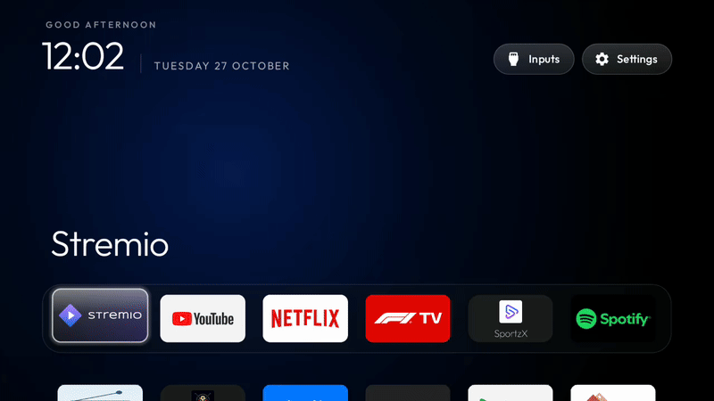
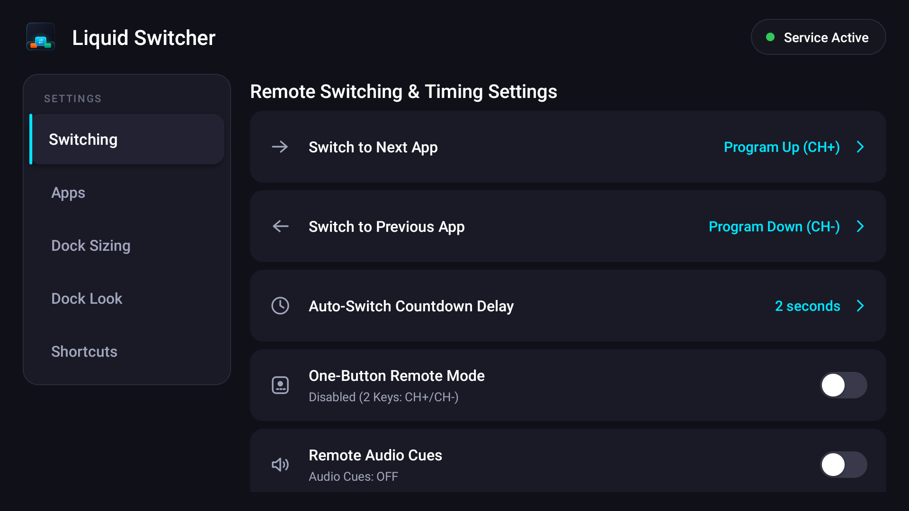
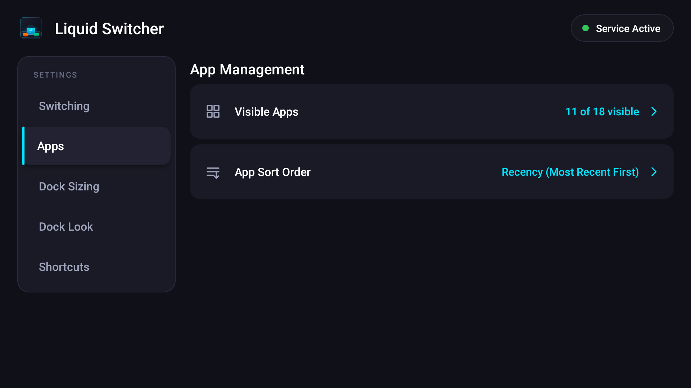
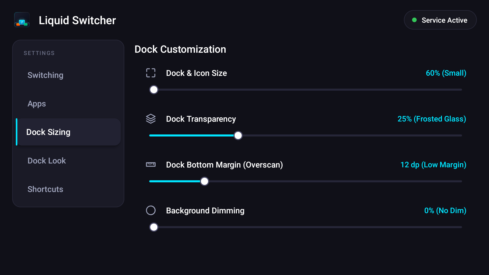
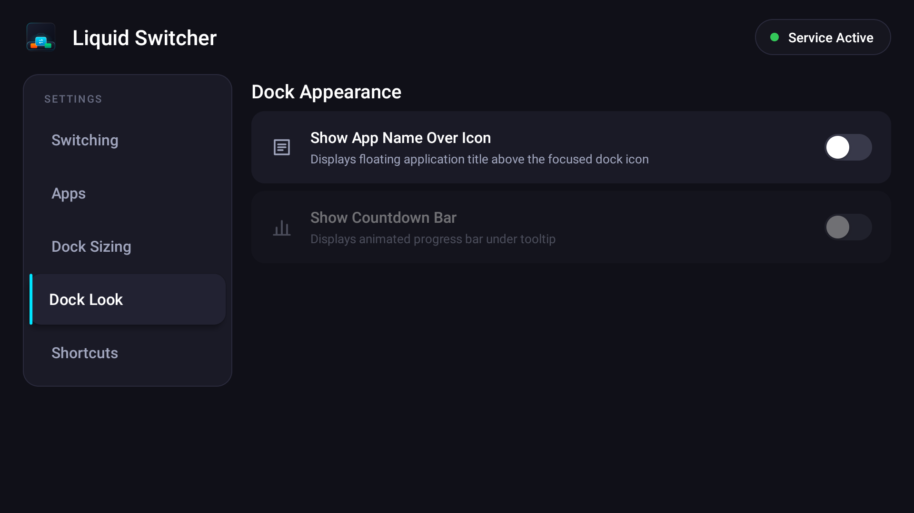
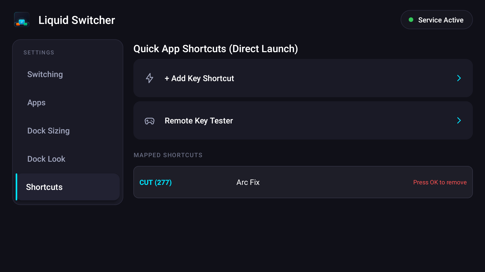

# Liquid Switcher

<p align="center">
  <a href="https://github.com/underd0se/LiquidSwitcher/releases/latest">
    
  </a>
  
  
  
</p>

A fluid, translucent obsidian-glass app switcher dock for **Android TV** and **Google TV**. Switch between running apps with a remote-triggered floating dock, spring-physics magnification, and zero-latency hardware key interception.

---

<div align="center">
  
  <p><em>Continuous Program Up cycling with spring-physics magnification, stopping on Google Play Store.</em></p>
  <p><a href="docs/images/demo.webm">▶ Download / View High-Resolution WebM</a></p>
</div>

---

## ✨ Features

- **Liquid Glass Dock**: Translucent obsidian gradient with specular highlights, frosted borders, and native GPU drop shadows.
- **Physics-Driven Motion**: Dynamic `SpringAnimation` bell-curve magnification with elevation lift on focused apps.
- **Global Key Capture**: Intercepts remote buttons (`CH+` / `CH-`, color keys, numeric keys) via Accessibility Service with microsecond navigation bypass.
- **Flexible Switching**: Dual-key cycling, single-key repeat mode, or direct one-touch shortcuts to specific apps.
- **App Management**: Filter hidden/system apps, sort alphabetically, by recency, or via custom drag-and-drop order.
- **Deep Customization**: In-app controls for dock scale (60%–140%), transparency (0%–90%), bottom margin, background dimming, and countdown timer.

---

## 📦 Download & Sideload

Download the latest prebuilt APK from [**Releases**](https://github.com/underd0se/LiquidSwitcher/releases/latest):

👉 **[Download LiquidSwitcher-v2.0.apk](https://github.com/underd0se/LiquidSwitcher/releases/download/v2.0/LiquidSwitcher-v2.0.apk)**

### Installation Methods

#### Option A: Downloader App (Recommended)
1. Install **Downloader by AFTVnews** from the Google Play Store on your TV.
2. Open Downloader and enter the direct APK URL or shortlink.
3. Select **Install**.

#### Option B: Send Files to TV
1. Install **Send Files to TV** on both your phone/PC and your TV.
2. Transfer `LiquidSwitcher-v2.0.apk` to the TV.
3. Open a file manager on TV (such as *File Commander* or *FX*) to install.

#### Option C: USB Drive
1. Copy `LiquidSwitcher-v2.0.apk` to a FAT32/NTFS formatted USB flash drive.
2. Insert into your Android TV and open via your TV's file manager.

#### Option D: ADB Command Line
```bash
adb connect <TV_IP>:5555
adb install -r LiquidSwitcher-v2.0.apk
```

---

## ⚙️ Initial Setup

1. **Launch Liquid Switcher** from your TV app drawer.
2. Select **Service Status** → Android Accessibility settings will open.
3. Select **Liquid Switcher Service** and toggle it **ON**.
4. Configure your preferred trigger keys (`CH+` / `CH-` by default), switch delay, and dock size.

---

## 📸 Settings Tour

Liquid Switcher includes a comprehensive, D-Pad optimized TV settings interface:

| Switching & Triggers | App Management & Sorting |
|:---:|:---:|
|  |  |
| *Configure trigger keys, single-key mode, and countdown timer.* | *Filter enabled apps and select Recency, Alphabetical, or Custom sort.* |

| Dock Geometry & Sizing | Visual Appearance & Glass |
|:---:|:---:|
|  |  |
| *Adjust dock scale (60%–140%) and bottom edge margin.* | *Tune obsidian transparency, background dimming, and sound cues.* |

<div align="center">
  <h3>Hardware Shortcuts</h3>
  
  <p><em>Map TV remote color keys (Red, Green, Yellow, Blue) directly to your favorite apps.</em></p>
</div>

---

## 🛠️ Developer Guide & CLI

For developers building from source, running tests, or inspecting logcat, see the [**Developer Guide**](docs/DEVELOPER_GUIDE.md) or the [**GitHub Wiki**](https://github.com/underd0se/LiquidSwitcher/wiki/Developer-Guide):

```bash
# Unified developer CLI
./dev.sh deploy   # Fast-build, install to TV, and bind accessibility service
./dev.sh trigger  # Broadcast dock overlay intent
./dev.sh shot     # Capture clean TV screenshot to captures/
./dev.sh test     # Run unit and Robolectric test suites
./dev.sh format   # Format Kotlin with Spotless + ktlint
```

---

## 📄 License

Released under the [MIT License](LICENSE).
